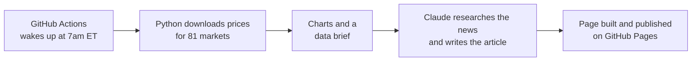

# The Morning Ledger

**An automated daily markets newspaper.** Every weekday at 7am New York time it collects data on 81 markets, draws the charts, has an AI research and write the day's story, and publishes a new edition, with no one pressing a button.

**Read today's edition → [cmacbain-1.github.io/Daily-Markets](https://cmacbain-1.github.io/Daily-Markets/)**  ·  [Past editions](https://cmacbain-1.github.io/Daily-Markets/archive.html)  ·  [About](https://cmacbain-1.github.io/Daily-Markets/about.html)

## What each edition covers

- **The big story**: the most important market move of the day, and why it happened
- **Around the world**: the US, Europe and Asia-Pacific
- **Sectors and stocks**: US sectors, Big Tech, banks and other heavyweights
- **Rates, currencies and commodities**: Treasury yields, the dollar, oil, gold and more
- **Crypto**: Bitcoin and the other majors
- **On the radar**: fast-rising themes such as AI chips, cybersecurity, uranium and India
- **What to watch today**: scheduled data releases, central bank speakers and earnings
- **Term of the day**: one finance concept explained in plain English
- Five charts, a "markets at a glance" data table, and the news sources used

## How it works

1. **Data:** `yfinance` pulls a year of daily prices for each market, and `pandas` works out the 1-day, 1-week, 1-month and year-to-date moves and 52-week ranges.
2. **Charts:** `matplotlib` draws five charts, sized to work as LinkedIn link previews.
3. **Writing:** Claude Code reads a brief containing all the numbers, searches the web for the news behind the moves, and writes the article. It is instructed to quote only the real data, explain jargon, give no investment advice, and cite its sources.
4. **Publishing:** `Jinja2` templates turn everything into a newspaper-style page. Each edition is saved to an archive, and GitHub Pages serves the site.

If the writing step fails on a given day, the edition still publishes with the numbers and charts, so a morning is never missed.

## Built with

Python · pandas · yfinance · Matplotlib · Jinja2 · Claude Code · GitHub Actions · GitHub Pages

## Project layout

| File | What it does |
|---|---|
| `config.yaml` | Settings: paper name, author, publishing time, and every market tracked |
| `make_edition.py` | The main program: `prepare`, `publish` and `rebuild` |
| `newsroom/market_data.py` | Downloads prices and calculates the moves |
| `newsroom/charts.py` | Draws the charts |
| `newsroom/writer.py` | The brief Claude follows when writing |
| `newsroom/page.py`, `newsroom/templates/` | Builds the web pages |
| `.github/workflows/daily-edition.yml` | The daily schedule |
| `docs/` | The published website, updated automatically |

<strong>Run your own copy</strong>

1. Copy this repository to your GitHub account.
2. Create a Claude subscription token by running `claude setup-token` with [Claude Code](https://code.claude.com) installed, and save it as a repository secret named `CLAUDE_CODE_OAUTH_TOKEN` (**Settings → Secrets and variables → Actions**).
3. Under **Settings → Pages**, set **Source** to **GitHub Actions**.
4. Edit `config.yaml` with your name, site address and markets.
5. On the **Actions** tab, open **Daily edition** and click **Run workflow**.

To change the design, edit the templates and run `python make_edition.py rebuild` to update every past edition too.

*For information and education only. Not financial advice.*
